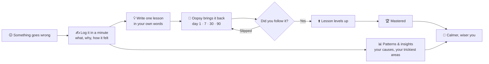

# Oopsy ⭐

### Oops today, wiser tomorrow.

Everyone makes mistakes. Almost nobody remembers what they taught them.

**Oopsy is a tiny, private diary for your mistakes.** Write down what went wrong, find the lesson, and let Oopsy bring it back right when you'd forget it. No account. No cloud. No judgement.

<p align="center">
  
  
  
</p>

---

## Why I built this

I kept making the same mistakes. The embarrassment passed, the lesson went with it, and a month later I did it all again.

So I built the app I wished I had: a place where a mistake stops being something to hide and becomes something to **use**.

*Built with love by Bharani.*

---

## How it works, and how it helps you



| Step | What it does for your mind |
|---|---|
| **Log it** | Getting it out of your head makes it smaller. |
| **Name the cause** | "I'm hopeless" is a feeling. "I rushed" is something you can fix. |
| **One lesson** | A single rule you believe beats a lecture. |
| **Spaced reminders** | The lesson returns right before you'd forget it. |
| **Gentle slips** | Slip and it just comes back sooner. No scores, no scolding. |
| **Insights** | Streaks and "1 fewer oops than last month" prove you're growing. |

Oopsy is a self-reflection tool, not a replacement for professional help. If you're struggling, please talk to someone you trust.

---

## Using it, day to day

1. **Say hello.** Pick a nickname and when you'd like a nudge.
2. **Tap the pink +** when something goes wrong.
3. **Open Review** when the badge shows, and answer honestly.
4. **Check Lessons and Insights** to see how far you've come.

A minute a day is all it takes.

---

## Run it

You need [Node.js](https://nodejs.org) 20+ and the **Expo Go** app.

```bash
npm install
npx expo start
```

Scan the QR code with your phone. Prefer a browser? `npx expo start --web`, then open `http://localhost:8081/?demo=1` for sample data.

Everything stays on your device.

**Built with** React Native, Expo SDK 58, React Navigation, AsyncStorage, SecureStore and local notifications.

---

<p align="center"><b>Made with love by Bharani</b><br/>Make mistakes. Keep the lessons.</p>
