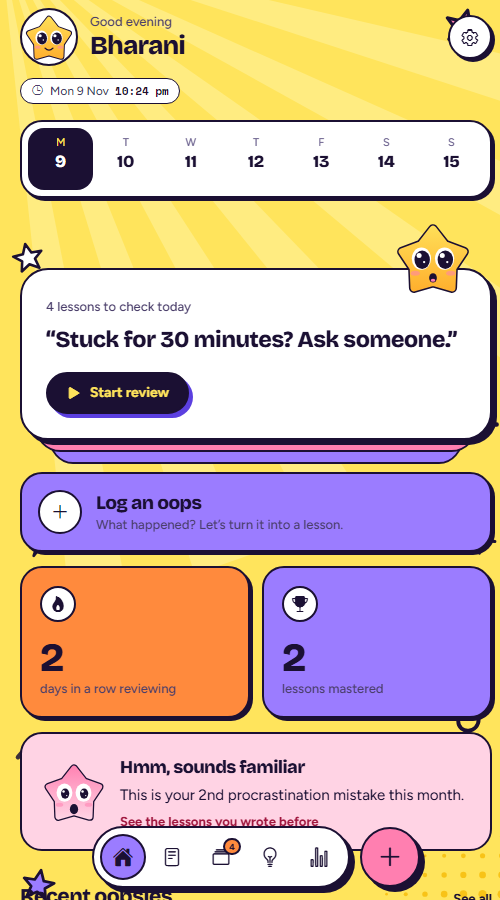
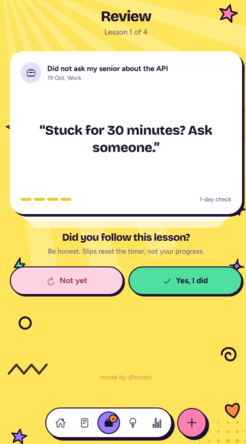
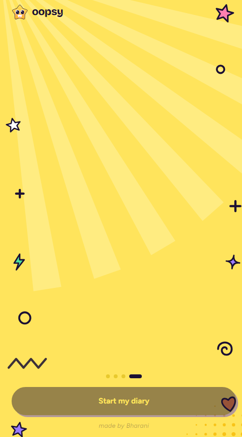
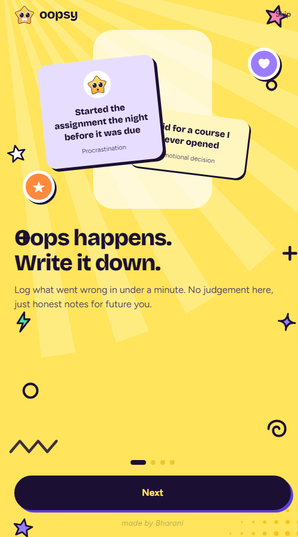
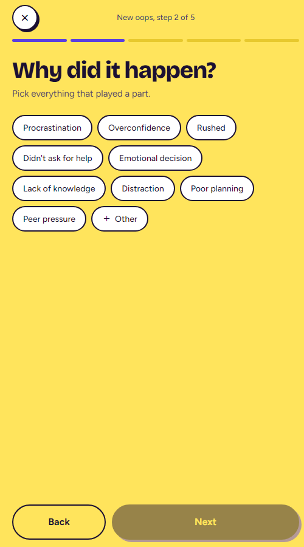
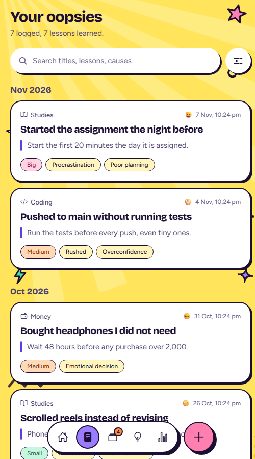
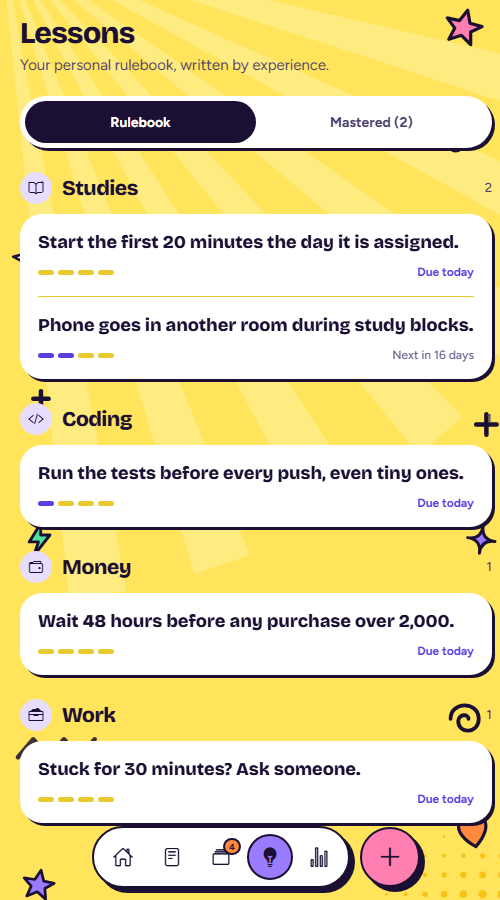
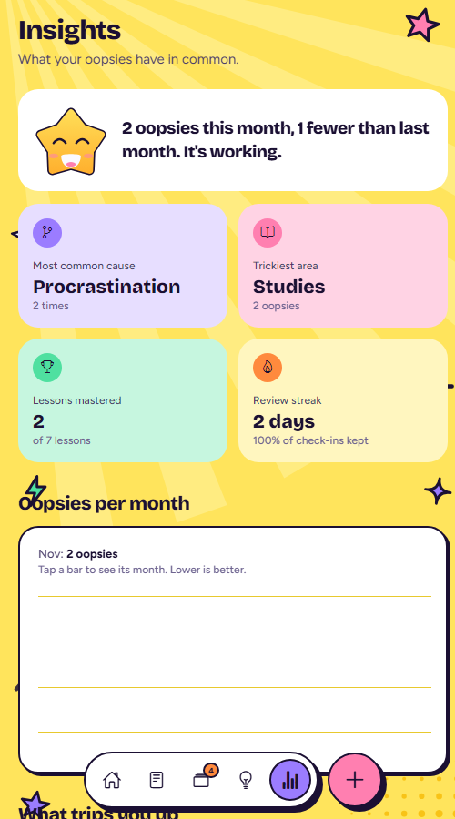
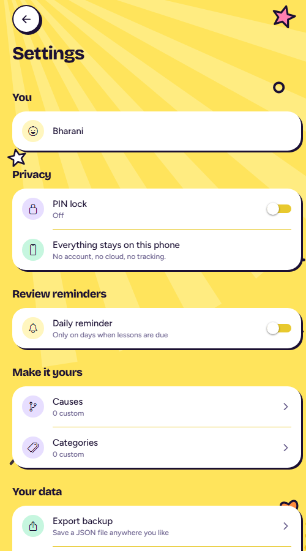

# Oopsy ⭐

### Oops today, wiser tomorrow.

Everyone makes mistakes. Almost nobody remembers what they taught them.

**Oopsy is a tiny, private diary for your mistakes.** Write down what went wrong, find the lesson inside it, and let Oopsy bring that lesson back right when you're about to forget it.

No account. No cloud. No judgement. Just you, getting a little wiser every day.

<p align="center">
  
  
  
</p>

---

## Why I built this

I kept making the same mistakes. Starting the assignment the night before. Buying things I didn't need. Not asking for help until it was too late.

It wasn't that I didn't care. I just never stopped to look at what had happened. The embarrassment passed, the lesson went with it, and a month later I did the exact same thing again.

So I built the app I wished I had: a place where a mistake stops being something to hide and becomes something to **use**.

*Built with love by Bharani.*

---

## How it helps your mind

Mistakes hurt most when we replay them with shame. Oopsy turns that loop into something kinder.

- **Writing it down lets it go.** Getting a worry out of your head and onto a page makes it smaller.
- **Naming the cause gives you power.** "I'm hopeless" is a feeling. "I rushed because I was distracted" is something you can fix.
- **One lesson, in your own words.** Not a lecture. One rule you actually believe.
- **Seeing progress calms you.** Your streak, your mastered lessons and your "1 fewer oops than last month" show that you are growing, not failing.
- **A friendly face, not a score.** Oopsy never scolds. When you slip, it just says: try again.

Oopsy is a self-reflection tool, not a replacement for professional help. If you're struggling, please talk to someone you trust.

---

## What you can do

| | |
|---|---|
| **Log an oops in a minute** | Five gentle steps: what happened, why, how it felt, how big it was, and what you'll do next time. |
| **Spot your patterns** | Oopsy tells you your most common cause, your trickiest area, and warns you softly when something sounds familiar. |
| **Never forget a lesson** | Each lesson returns after **1, 7, 30 and 90 days**. Follow it and it moves up. Slip and it comes back sooner. |
| **Watch yourself grow** | Streaks, mastered lessons and a monthly chart that shows your oopsies going down. |
| **Search everything** | Find any past mistake by title, lesson or cause. |
| **Keep it private** | PIN lock and fingerprint or face unlock. Everything stays on your phone. |
| **Gentle reminders** | Pick morning, afternoon, evening or night for a daily nudge. |
| **Back up and restore** | Export your diary to a file and bring it back any time. |

---

## A look inside

<p align="center">
  
  
  
  
</p>
<p align="center">
  
  
</p>

---

## How to use it, day to day

1. **Say hello.** Tell Oopsy your nickname, what you want to get better at, and when to remind you.
2. **Something went wrong? Tap the pink +.** Write what happened, pick the causes, note how you felt, and finish with one lesson in your own words.
3. **Check in.** Open **Review** when the badge shows. Read your lesson and answer honestly: did you follow it?
4. **Be honest, not perfect.** A slip only means the lesson comes back sooner.
5. **Look back.** **Lessons** is your personal rulebook. **Insights** shows how far you've come.
6. **Keep the streak.** A minute a day is all it takes.

---

## Tour of the app

| Tab | What it's for |
|---|---|
| **Home** | Today's date and time, your week at a glance, lessons due now, streak and mastered count. |
| **Log** | Every oops you've written, grouped by month, with search. |
| **Review** | Flip through lessons that are due and tell Oopsy how you did. |
| **Lessons** | Your rulebook, grouped by area, with progress through the 1 / 7 / 30 / 90 day steps. |
| **Insights** | Your causes, your trickiest areas and a monthly trend. |

---

## Run it yourself

You need [Node.js](https://nodejs.org) 20+ and the **Expo Go** app on your phone.

```bash
npm install
npx expo start
```

Scan the QR code with Expo Go (Android) or the Camera app (iOS). Your phone and computer need to be on the same Wi-Fi. If they can't see each other, use `npx expo start --tunnel`.

Prefer a browser? Run `npx expo start --web`. To see the app filled with sample data, open `http://localhost:8081/?demo=1`.

**Good to know**
- Review reminders are local notifications and work in Expo Go.
- Biometric unlock needs a phone with a fingerprint or face sensor.
- Nothing ever leaves your device.

## Built with

React Native, Expo SDK 58, React Navigation, AsyncStorage, SecureStore, local notifications, SVG, and a lot of care.

---

<p align="center"><b>Made with love by Bharani</b><br/>Make mistakes. Keep the lessons.</p>
